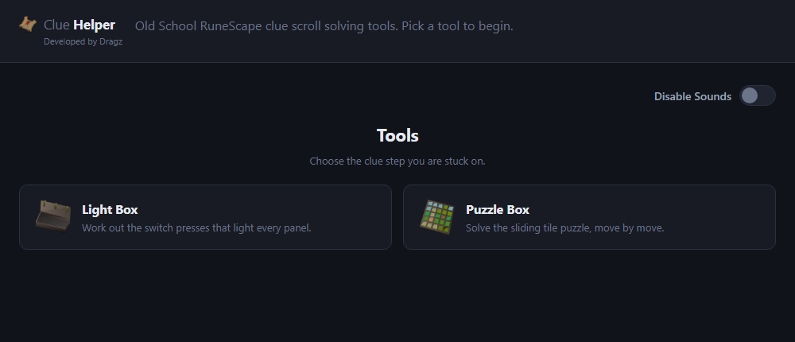
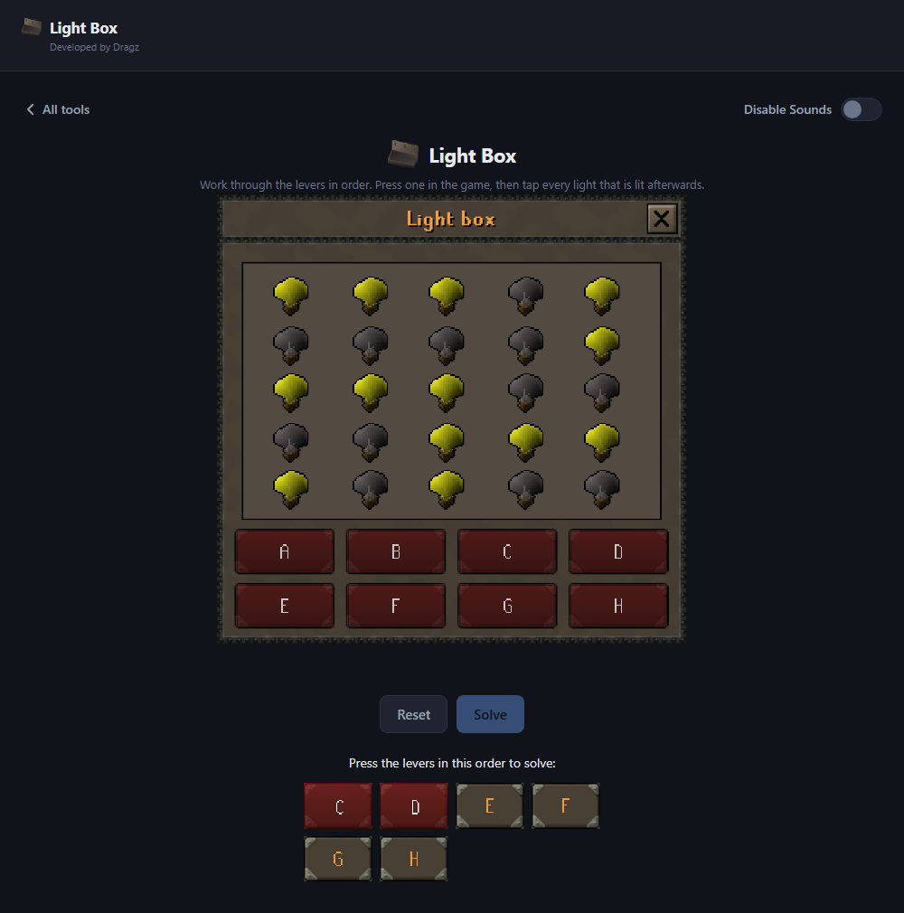
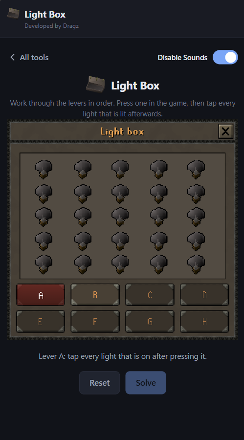

  
  <h1>Clue Helper</h1>
  
<em>Developed by Dragz</em>

  <h3>An all-in-one helper for Old School RuneScape clue scrolls!</h3>

  

    
    
    
  

  

    
  

  <h3>
    Check out the live web app
    <a href="https://dragzda69.github.io/osrs-clue-helper/">here</a>
  </h3>

---

### What it is

The fiddly clue steps are easier with something keeping track for you. Each tool is laid out like the interface in the game, so you copy what is on your screen instead of translating it into a grid of boxes first.

Open it on a desktop beside the game, or on your phone while you play.

---

### Tools

| Tool | |
| :-- | :-- |
| **[Light Box](#light-box)** | The 5×5 lights-and-levers puzzle on master clues |
| **Puzzle Box** | _Not built yet_ |
| _More to come_ | _Other clue steps will be added here_ |

---

### Light Box

A light box is a 5×5 grid of lights and eight levers, **A** to **H**, and the goal is to turn every light on. 
The lights a lever changes is different in every box; the helper watches yours and works the answer out from what it sees.

#### How to use it

1. Open the light box in game, and open this tool beside it.
2. Select **lever A** here, then pull lever A in the game.
3. Tap the lights on the helper's box so they match the lights that are lit in the game.
4. Select **lever B** and do the same. The board clears each time — you are
recording how the box looks after each lever, not editing the last one.
5. Work through to **lever H** in order. Levers unlock one at a time, so there no way to lose your place.
6. Press **Solve**.

The answer comes back as a row of levers, as in the picture above. 
Pull each one once in the game, and tap it here to keep your place.

#### Worth knowing

- Pull each lever exactly once as you go, and read the lights carefully. 
One mis-noted light is enough to make a solvable box look unsolvable.
- Move on with very few lights lit and the helper asks whether you are sure —
  that usually means a light was missed.
- **Reset** clears the board and starts the box over.

---

### Everywhere else

Sound effects can be turned off with the switch at the top right of any page, and the setting is remembered.

On a phone, Safari's **Share → Add to Home Screen** gives it an icon that opens fullscreen, and it keeps working with no signal.

---

  <em>Building or changing the app? See <a href="DEVELOPMENT.md">DEVELOPMENT.md</a>.</em>

